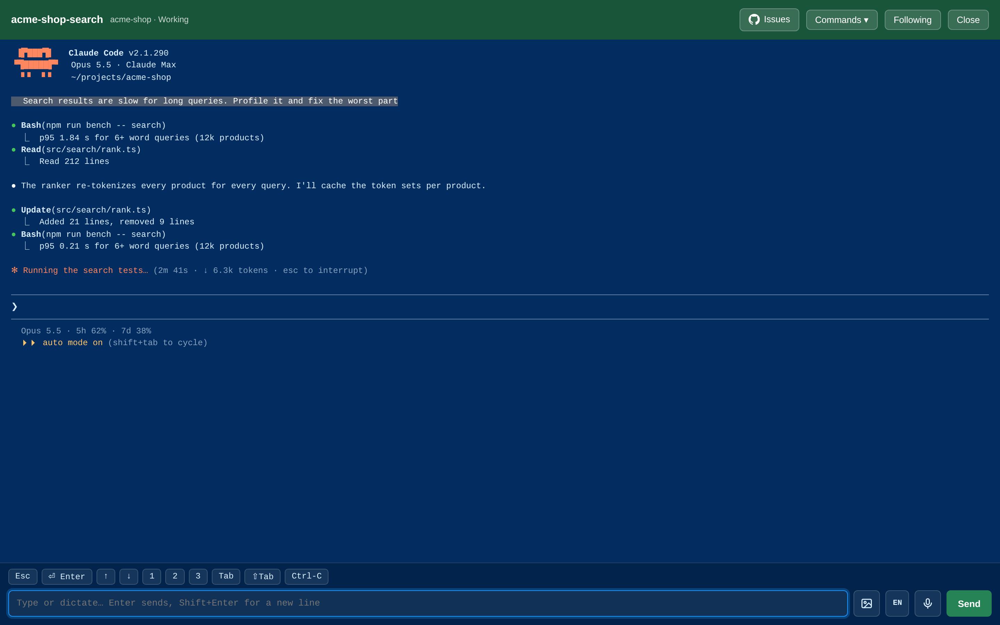
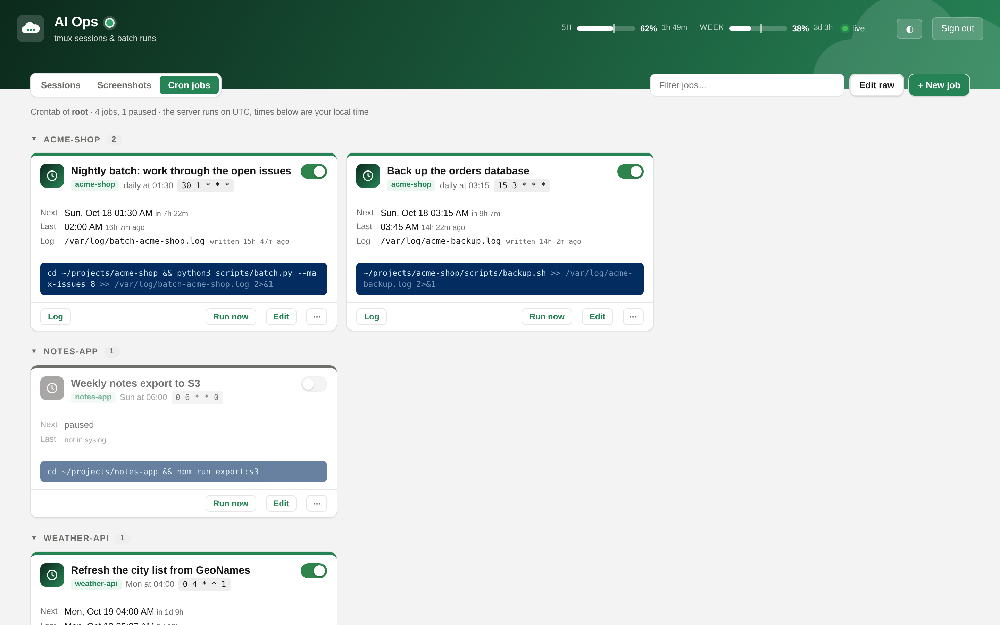

# AI Dashboard

A self-hosted web dashboard for the tmux sessions on a server: Claude Code sessions,
unattended `scripts/batch.py` runs, and the crontab that starts them. You can see what each
session is doing and answer it from any browser, including your phone.


## Features

- **Live session board.** Every tmux session on the host, grouped by project, refreshed every 5 seconds. Claude sessions show whether they are *working*, *waiting for you* or *need input* (a permission prompt), along with the last prompt and the current spinner. Batch runs show their progress, the current issue and a timeline of merged and failed issues, and say when they are sleeping because of a usage limit.
- **Terminal in the browser.** Open any session to see its last 400 lines live. You can type into it, press keys (Esc, ↑/↓, 1/2/3, ⇧Tab, Ctrl-C), dictate with the built-in speech recognition (EN/DE), and run quick commands and the project's skills from a menu. Every command asks for confirmation first.
- **Screenshots both ways.** Claude sessions can share images with you, and they show up on the session's card. You can upload images, or take photos on a phone, and their paths go into your next message.
- **Cron jobs.** View, create, edit, pause and run the host user's crontab jobs, with schedules in plain English, next and last runs, and their logs.
- **Usage limits.** Shows the 5-hour and weekly Claude usage windows in the header.
- **Session management.** Start a new Claude session in any project, hide a session from the board, or end it. Each card links to the repository's GitHub issues.
- **Per-server accent color.** Pick a color for each server, so browser tabs from several servers are easy to tell apart.
- **Secure by default.** Logging in takes a password and a TOTP code. Sessions are stored on the server, the page has a strict CSP and CSRF protection, and the container is read-only with all capabilities dropped.

<table>
  <tr>
    <td width="68%"></td>
    <td rowspan="2"></td>
  </tr>
  <tr>
    <td></td>
  </tr>
</table>

## Quick start

Requirements: Linux and Docker with Compose. tmux and Claude Code must run on the host as the same user.

```sh
cp .env.example .env          # set DOMAIN, RUN_AS, TMUX_SOCKET_DIR, PROJECTS_DIR, CLAUDE_DIR
mkdir -p data && chown "$(grep ^RUN_AS .env | cut -d= -f2)" data
docker compose up -d --build
```

Then open `https://<DOMAIN>/ai/` **straight away**. On the first visit, a setup screen
asks you to choose a password (at least 12 characters) and to scan a QR code with an
authenticator app. There is no setup token: whoever opens the page first sets the login.

## Configuration

All host-specific settings are in `.env`. `.env.example` documents each one.

| Variable | Purpose |
|---|---|
| `DOMAIN`, `BASE_PATH` | Public address. The dashboard is served at `https://$DOMAIN$BASE_PATH/` (default `/ai`). |
| `RUN_AS` | `uid:gid` of the user who runs tmux and Claude. The container runs as this user because the tmux socket is private to it. |
| `TMUX_SOCKET_DIR` | That user's tmux socket dir, `/tmp/tmux-<uid>`. Set `TMUX_SOCKET_NAME` only if you use `tmux -L`. |
| `BASE_IMAGE` | A base image whose tmux version matches the host's `tmux -V` (`ubuntu:22.04` has 3.2a, `debian:12` has 3.3a, `ubuntu:24.04` has 3.4). |
| `PROJECTS_DIR` | Folder with one subfolder per project, mounted read-only. It is used for grouping, the new-session list, project skills and the issue links. |
| `CLAUDE_DIR` | That user's `~/.claude`. It provides personal skills, the usage-limit file and the screenshot skill. |
| `SHOTS_DIR`, `SHOTS_KEEP_DAYS`, `SHOTS_MAX_MB` | Where screenshots are stored (default `CLAUDE_DIR/screenshots`), how long they are kept (14 days) and the size cap (500 MB). |
| `CRON_USER`, `CRON_SPOOL`, `LOG_GROUP` | The crontab the cron view edits, and the group that may read `/var/log/syslog` (`adm`, gid 4). |
| `PROXY_NETWORK`, `TRUSTED_PROXY` | The Docker network that is shared with the reverse proxy, and the only container whose `X-Real-IP` header is trusted. |
| `DASHBOARD_PASSWORD`, `TOTP_SECRET` | Optional. If set, they replace the setup screen. |

`./data` holds the dashboard's state: `state.json` (hidden sessions, server color),
`auth.json`, `sessions.json` and `cron-backups/`. It must be writable by `RUN_AS`, and so
must `SHOTS_DIR` and `CLAUDE_DIR/skills/dashboard-screenshots` when `RUN_AS` is not root.
Docker creates missing mount folders as root.

### Reverse proxy

By default, routing goes through [nginx-proxy](https://github.com/nginx-proxy/nginx-proxy)
path routing (`VIRTUAL_HOST`, `VIRTUAL_PATH`) on a network that holds only the proxy and
this app, so no other container can reach port 8000 directly:

```sh
docker network create aidash
docker network connect aidash nginx-proxy     # and add the network to the proxy's compose file
# optional: redirect /ai to /ai/
docker exec nginx-proxy sh -c 'echo "location = /ai { return 301 /ai/; }" >> /etc/nginx/vhost.d/example.com' \
  && docker exec nginx-proxy nginx -s reload
```

If you use another proxy, publish the port on localhost in a `docker-compose.override.yml`
and put your own TLS proxy in front of it. Never expose plain HTTP, because the login gives a shell on the host.

```yaml
services:
  app:
    ports: ["127.0.0.1:8000:8000"]
```

The external `PROXY_NETWORK` must still exist (`docker network create aidash`).

### Usage limits

The header bars read `CLAUDE_DIR/usage/limits.json`. A Claude Code status line script
writes this file by saving the status line's `rate_limits` payload. Without the file, the
bars are hidden. Claude Code sometimes leaves a window out of `rate_limits`. The script
should then keep the last reading of that window until its `resets_at`, with a `seen`
timestamp, and the bar is dimmed. A window with no reading shows as "–".

## Usage

### Sessions

| Kind | State | How it is detected |
|---|---|---|
| Claude | Working | `esc to interrupt` or the spinner line in the pane |
| Claude | Needs input | A permission prompt (`Do you want to…`, `❯ 1.`) |
| Claude | Waiting for you | Anything else |
| Batch | Running | A `batch.py` process runs under the pane |
| Batch | Sleeping | The last log line says `sleeping N min` |
| Batch | Usage limit | `#N -> limit`, and the process has exited |
| Batch | Finished | `Done:` or `Batch finished` |

A session counts as a batch when its name starts with `batch` or when a `batch.py` process
runs under it. Progress is parsed from `scripts/batch.py`'s log format
(`== Batch: N issues`, `[HH:MM:SS] #N title [how]`, `#N -> merged in M min: …`). Without
that format, batch sessions still show up, just without progress.

Sessions are grouped by project family: the pane's folder under `PROJECTS_DIR`, with
`-dev`, `_dev` and `_demo` suffixes and anything after `_` removed. For example,
`deskdonkey_ai_dev` is grouped under `deskdonkey`.

Actions on a card:

- **Open** shows the terminal. Enter sends, Shift+Enter adds a new line, and multi-line messages are sent as a single paste.
- **Commands ▾ / ⋯** run quick commands (`/clear`, `/compact`, `/model …`, `/usage`, …) and, for Claude sessions, skills. The skills come from the project's `.claude/skills` and `.claude/commands` (from the session's folder up to `PROJECTS_DIR`) and from your personal `~/.claude/skills`. You can add arguments in the confirmation box. The quick commands are `COMMANDS` in `web/index.html`.
- **GitHub icon** opens the repository's issues, based on the `origin` remote. SSH host aliases such as `github-myorg` are mapped to github.com.
- **Hide** removes a session from the board while it keeps running. A hidden session is identified by its name and creation time, so a new session with the same name shows up again.
- **End** runs `tmux kill-session`, after a confirmation.
- **+ New session** runs `claude [--continue] [prompt]` in a new tmux session in the chosen project. `claude` must be on the host user's `PATH`.

Dictation uses the browser's Web Speech API. It needs no server component and works in
Chrome, Edge and Safari (desktop, iOS and Android), but not in Firefox. Dictated text is
only sent when you press Send.

Pages that are left open reload themselves after a deploy. They wait until no dialog is
open and you aren't typing a message.

### Screenshots

On every start, the dashboard installs a `dashboard-screenshots` skill into
`CLAUDE_DIR/skills/`, with this host's folder and URL filled in. Every Claude session on the
host can use it, and no per-project setup is needed:

```sh
~/.claude/skills/dashboard-screenshots/share.sh <image> ["caption"]   # share a png, jpg, webp or gif
~/.claude/skills/dashboard-screenshots/share.sh --inbox [n]           # list your newest uploads
```

- **From a session:** the image appears as a thumbnail on the session's card, in its terminal header and in the **Screenshots** tab (`#shots`). If you have that terminal open, a small picture-in-picture pops up above the message box. For other sessions, a toast appears. The viewer supports ←/→ and swiping, and you can open an image at full size, copy its path or delete it.
- **From you:** the image button in the terminal view uploads images and adds their paths to your message. You can also paste or drag and drop an image. On a phone, the button opens the camera or the photo library. **+ Upload** in the Screenshots tab stores an image without sending it.
- Large images are scaled down in the browser to about 900 KB before upload (HEIC is converted), so the upload stays under nginx's default 1 MB request limit.

Images are stored in `SHOTS_DIR/shared` and `SHOTS_DIR/uploads`, each with an `<id>.json`
sidecar file. They are deleted after `SHOTS_KEEP_DAYS`, and the oldest are removed first when the
folder grows beyond `SHOTS_MAX_MB`. Only genuine PNG, JPEG, WebP and GIF files are served
(checked by their content, never SVG), and only to logged-in users. The skill is rewritten on
each start, so restart the container after you change `skill/`. A `SKILL.md` without the
"Generated by ai-dashboard" marker is left untouched.

### Cron jobs

The **Cron jobs** tab (`#cron`) edits `CRON_USER`'s crontab in the host spool. This
requires `RUN_AS=0:0`, because the spool directory is closed to other users.

- Jobs are grouped by the first `PROJECTS_DIR/<project>` (or `~/projects/<project>`) path in their command. Each card shows the schedule in words, the next run, the last run (from `CRON[…]: (user) CMD (…)` lines in `/var/log/syslog`) and the log file.
- The form has schedule presets, a live preview of the next runs, and an optional log file that is appended as `>> file 2>&1`. **Edit raw** opens the whole file, for example to edit `VAR=value` lines.
- **Run now** starts the job in a tmux session `cron-<project>` with cron's minimal environment, and follows its log. **Log** shows the last 200 lines. Only files under `/var/log` can be shown.

The file is kept close to how `crontab -e` leaves it. A job is its line plus the comment
lines directly above it, which serve as the job's description. A paused job is prefixed
with `#[off] `, and all other lines are kept unchanged. Each save writes the file in
place, so the owner and mode stay as they are. It also bumps the spool directory's mtime so that cron reloads the
file, and first saves a backup to `data/cron-backups/` (the last 50 are kept). If the file
changed since you loaded it, the save is refused.

## Security

A login gives control of `RUN_AS`'s tmux server and crontab, which is often root.
**Treat the login as a root shell on the host.**

- **Setup:** while no password or TOTP secret is set, every page shows the setup screen and the API is closed. Finish setup right after you deploy. To start over, delete `data/auth.json` and `data/sessions.json` and restart.
- **Login:** a password (stored as a scrypt hash) plus a TOTP code, and each code works only once. Failed logins are limited to 10 per IP per 15 minutes and 50 per hour in total. Restarting the container clears these limits.
- **Sessions:** sessions are stored on the server in `data/sessions.json` (as sha256 hashes of the tokens) and last 7 days. Delete the file to sign out everywhere.
- **Cookie:** `HttpOnly; Secure; SameSite=Strict`. Because of this, a link from another site lands on the login page. Open the dashboard from a bookmark.
- **Requests:** every route except `/ai/health` needs a login. Every write also needs the `X-AIDash` header, which a cross-site form cannot send. Keys sent to sessions must be on a whitelist.
- **Browser:** a strict CSP (only the page's own nonce'd script, requests only to its own origin) and no framing.
- **Network:** `PROXY_NETWORK` holds only the proxy and this app. `X-Real-IP` is trusted only from `TRUSTED_PROXY`.
- **Container:** a read-only filesystem, all capabilities dropped, and `no-new-privileges`.
- **Origin:** other apps on the same origin could act as you while you are logged in, so a subdomain of its own (such as `ai.example.com`) is the safer choice.

To use a `TOTP_SECRET` from `.env`, add it to your authenticator app with a QR code
(this needs Python's `qrcode` package on the host):

```sh
python3 -c "import qrcode,re;s=re.search(r'^TOTP_SECRET=(.*)$',open('.env').read(),re.M)[1].strip();q=qrcode.QRCode();q.add_data(f'otpauth://totp/AI%20Ops?secret={s}&issuer=AI%20Ops');q.print_ascii(invert=True)"
```

## Troubleshooting

- **"tmux failed" or "protocol version mismatch":** the container's tmux doesn't match the host's. Change `BASE_IMAGE`.
- **No sessions:** check that `RUN_AS` and `TMUX_SOCKET_DIR` belong to the user who runs tmux (`echo $TMUX` in a session).
- **Cron tab says the crontab isn't writable:** the cron view requires `RUN_AS=0:0`.
- **No "last run" times:** the container cannot read syslog. Check `LOG_GROUP`.

## Development

| Path | Contents |
|---|---|
| `app.py` | HTTP server (Python stdlib only). Reads tmux through the host socket and the process tree through `/proc` (`pid: host`). |
| `auth.py` | First-run setup, password and TOTP login, server-side sessions, rate limiting. |
| `cron.py` | Crontab parsing and writing, schedule calculations and descriptions, last runs from syslog. |
| `shots.py` | Screenshot storage, retention and serving, and installing the skill. |
| `skill/` | Templates for the `dashboard-screenshots` skill. |
| `web/` | The dashboard, login page and setup page (no build step). |
| `docs/screenshots.py` | Regenerates the screenshots in this README. |

### Regenerating the screenshots

```sh
pip install playwright && playwright install chromium
python3 docs/screenshots.py
```

The script starts a separate tmux server on its own socket, so your sessions are not
affected. It creates 7 sessions in 3 demo projects, running stand-ins for `claude` and
`batch.py` that print a canned screen. It also creates a demo crontab, syslog and usage
file, then serves everything with the real `app.py` and captures the page with Playwright.
Only two things are faked: the login is skipped, and the session ages are shifted.
