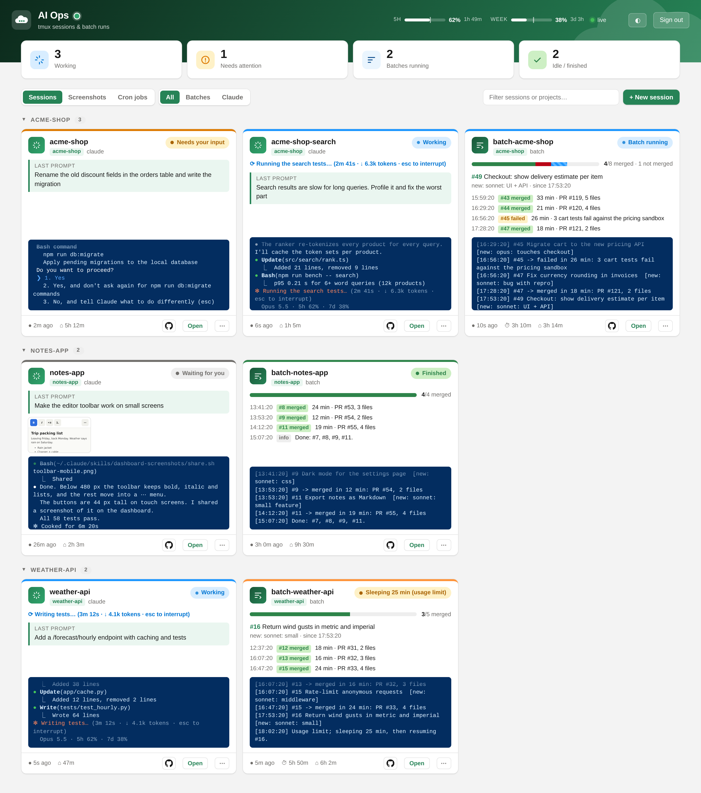
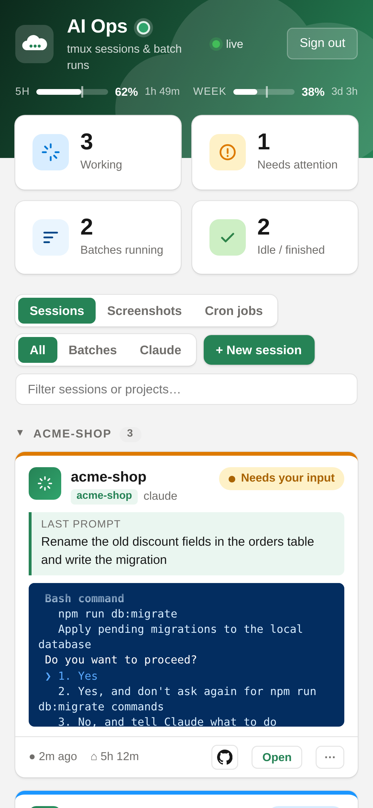

# AI dashboard

Password-protected control page for a server's tmux sessions: Claude sessions
(working / waiting for you / needs input) and `scripts/batch.py` runs (progress,
current issue, merged/limit events). It runs on any Linux host with Docker.

The screenshots show made-up demo data. `docs/demo.html` is the same page as a static file
with that data built in (`docs/mock.js`). `python3 docs/build_demo.py` rebuilds it from
`web/index.html` and retakes the screenshots (needs Playwright with Chromium).

You can also act on sessions from the page:
- **Open** a session's terminal. It shows the last 400 lines live, and you can type into it (Enter sends) or press keys (Esc, ↑/↓, 1/2/3, ⇧Tab, Ctrl-C).
- **Dictation** (mic button next to Send) uses the browser's built-in speech recognition (Web Speech API). It is free with no server part and works in Chrome, Edge and Safari (iOS, Android) but not Firefox. The EN/DE toggle sets the language. Dictated text lands in the box and is only sent when you press Send.
- **Commands ▾** / **⋯** offer quick commands (`/clear`, `/compact`, `/model …`, `/usage`, …). Each one asks for confirmation first. The list is `COMMANDS` at the top of the script in `web/index.html`.
- Claude sessions also get **skills** in that menu: the project's `.claude/skills` and `.claude/commands` (from the session's folder up to `PROJECTS_DIR`) plus your personal `~/.claude/skills`. You can add arguments in the confirmation box.
- The **GitHub icon** links to the repo's issues, taken from the `origin` remote. SSH host aliases like `github-the-drift` are mapped to github.com.
- **Hide** a session. It keeps running but drops off the board. Hidden sessions are stored in `data/state.json`, keyed by name plus creation time, so a new session that reuses the name shows up again.
- **End** a session (`tmux kill-session`, with confirmation).
- **+ New session** starts a Claude session in a project under `PROJECTS_DIR`: `tmux new-session` + `claude [--continue] [prompt]`. The project list comes from a read-only mount of `PROJECTS_DIR`. `claude` must be on the host user's PATH.

### Cron jobs

The **Cron jobs** tab (toggle next to the filters, or `/ai/#cron`) manages the host user's crontab
(`CRON_USER`):

- Each job is a card grouped by project, which is taken from the first `PROJECTS_DIR/<project>` path in the command. A card shows the schedule in words, the **next run**, the **last run**, and the log file with when it was last written.
- **Create / Edit** use a form with a description, a schedule (with presets and a live preview of the next runs), the command and an optional log file. The log file field becomes `>> file 2>&1` at the end of the command.
- The **switch** pauses or enables a job. **⋯** offers duplicate and delete. **Edit raw** opens the whole file for anything the form doesn't cover, such as `VAR=value` lines.
- **Run now** starts the job in a tmux session `cron-<project>` with cron's environment (`env -i`, `/bin/sh`, `PATH=/usr/bin:/bin`) and opens its terminal. If the job writes a log, the new lines show live.
- **Log** shows the last 200 lines of the job's log. Only files under `/var/log` can be shown.

How the file is kept:

- A job is its line plus the comment lines right above it, which are its description. A paused job is the line prefixed with `#[off] `. Ordinary comments that look like a job, such as the example in the stock header, stay comments.
- Every other line is kept exactly as it is. A file you edit with `crontab -e` reads back the same.
- Saves are written in place, which keeps the owner, group and mode that `crontab` set. The spool dir's mtime is then bumped, and cron re-reads the file within a minute (you'll see `RELOAD` in syslog). Every save first copies the old file to `data/cron-backups/` (the last 50 are kept).
- Every write carries the version it was based on. If the file changed in the meantime (for example through `crontab -e`), the save is refused with "reload and try again".
- "Last run" comes from the `CRON[…]: (user) CMD (…)` lines in `/var/log/syslog` and `syslog.1`. The container needs read access to syslog through `LOG_GROUP` (adm, gid 4).

Mounts: `CRON_SPOOL` (default `/var/spool/cron/crontabs`) at `/cron` and `/var/log` read-only at `/hostlog`.
The spool dir is closed to other users, so this only works with `RUN_AS=0:0`. Otherwise the tab says the crontab isn't writable.

- `app.py`: stdlib HTTP server. It reads tmux through the host socket and the process tree through `/proc`.
- `cron.py`: crontab parsing and writing, schedule maths (next runs, plain-English description), last runs from syslog.
- `web/`: the login page and the dashboard (auto-refreshes every 5 s, "Open" shows the last 400 lines of a pane).
- `auth.py`: login: first-run setup, password + TOTP, server-side sessions, failed-login limits.
- `.env` (not committed, template in `.env.example`): all host-specific settings, optionally `DASHBOARD_PASSWORD` / `TOTP_SECRET` (otherwise the setup screen sets them).

## Security

Logging in means driving root's tmux and crontab, so a login is a root shell on the host.

- **First run**: with no password or no TOTP secret (neither in `.env` nor in `data/auth.json`), every page shows the setup screen and the API is closed. There is no setup token: whoever opens it first sets the login, so finish setup right after deploying (if a password is already set and only the TOTP is missing, setup asks for that password). Step 1 sets the password (12+ characters, stored as a scrypt hash), step 2 shows a QR code for the authenticator app and saves only once a code from the app checks out. To start over: delete `data/auth.json` and `data/sessions.json`, restart, open the dashboard.
- **Login**: password plus a TOTP code (a code works once). Failed logins are limited to 10 per IP per 15 min and 50 in total per hour (then nobody can log in for up to an hour; restart the container to clear it).
- **Sessions** are server-side in `data/sessions.json` (sha256 of each token, 7 days). Sign out ends the session; delete the file to end all of them.
- **Cookie**: `HttpOnly; Secure; SameSite=Strict`, so a link from another site opens the login page; open the dashboard from a bookmark.
- **Network**: `PROXY_NETWORK` holds only nginx-proxy and this app, so other containers can't reach port 8000 and skip the proxy. `X-Real-IP` is only believed from `TRUSTED_PROXY`.
- **Browser**: strict CSP (only the page's own nonce'd script, requests to itself), no framing. Writes need the `X-AIDash` header.
- Other apps on the same origin (`example.com/...`) could act as you while you're logged in; a subdomain of its own avoids that.

If `TOTP_SECRET` is set in `.env` instead, add it to an authenticator app with a QR code (on the host, python3 with `qrcode`):

    python3 -c "import qrcode,re;s=re.search(r'^TOTP_SECRET=(.*)$',open('.env').read(),re.M)[1].strip();q=qrcode.QRCode();q.add_data(f'otpauth://totp/AI%20Ops?secret={s}&issuer=AI%20Ops');q.print_ascii(invert=True)"

## Deploy

    cp .env.example .env     # fill in DOMAIN, paths, RUN_AS
    docker compose up -d --build
    # then open the dashboard right away and follow the setup screen (the first visitor sets the login)

What `.env` has to match on the host:

- **`RUN_AS` / `TMUX_SOCKET_DIR`**: the user who runs tmux and Claude, and their socket dir (`/tmp/tmux-<uid>`). The container runs as that user because the socket is private to it. `./data` must be writable by it (`mkdir -p data && chown <uid>:<gid> data`).
- **`BASE_IMAGE`**: its tmux must match the host's `tmux -V` (protocol versions must match). If the versions don't match, the dashboard shows "tmux failed" or "protocol version mismatch".
- **`PROJECTS_DIR`**: one folder per project. The new-session list and grouping come from it.
- **`CLAUDE_DIR`**: optional extras. `skills/` adds personal skills to the menu. `usage/limits.json` feeds the usage-limit bars and is written by a Claude Code status line script that saves the status line's `rate_limits` payload. Without it, the bars don't show.
- **batch progress**: this needs `scripts/batch.py`'s log format (see below). Without it, sessions still show up, just without batch progress.

Routing is nginx-proxy path routing (`VIRTUAL_HOST=$DOMAIN`, `VIRTUAL_PATH=$BASE_PATH/`)
on the external `PROXY_NETWORK` (a network of its own: `docker network create aidash && docker network connect aidash nginx-proxy`, and add it to the proxy's compose so it survives a recreate). The bare `/ai` → `/ai/` redirect is a one-line rule
in nginx-proxy's vhost.d:

    docker exec nginx-proxy sh -c 'echo "location = /ai { return 301 /ai/; }" >> /etc/nginx/vhost.d/example.com' && docker exec nginx-proxy nginx -s reload

Without nginx-proxy, publish the port in a `docker-compose.override.yml` and put
your own TLS proxy in front. Don't expose plain HTTP: the password is a shell on the host.

    services:
      app:
        ports: ["127.0.0.1:8000:8000"]

(The external `PROXY_NETWORK` must still exist: `docker network create aidash`.)

## How state is detected

| Kind | State | Signal |
|---|---|---|
| batch | running | a `batch.py` process under the pane |
| batch | sleeping | last log line says `sleeping N min` |
| batch | usage limit | `#N -> limit` and the process has exited |
| batch | finished | `Done:` / `Batch finished` |
| claude | working | `esc to interrupt` or the spinner line |
| claude | needs input | permission prompt (`Do you want to…`, `❯ 1.`) |
| claude | waiting for you | everything else |

Sessions are grouped by project family: the pane's directory under
`PROJECTS_DIR`, with `_dev`/`-dev`/`_demo` and anything after `_` stripped.
For example, `deskdonkey_ai_dev` is grouped under `deskdonkey`.

## Security

The tmux socket gives full control of the host's tmux, and the dashboard uses
it: it types into sessions and starts new ones. In effect, the password is a
shell as `RUN_AS` on the host (often root). All routes except `/ai/health` need the password.
Every write (`POST /ai/api/…`) also needs the `X-AIDash: 1` header, which a
cross-site form can't send. Keys are limited to a whitelist. Failed logins are limited to
10 per IP per 15 minutes. The container is read-only and runs with all
capabilities dropped. Change the password in `.env`, then run
`docker compose up -d`.
